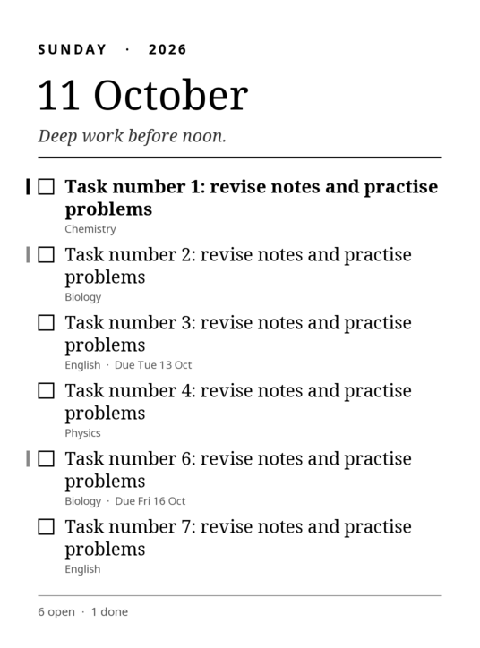
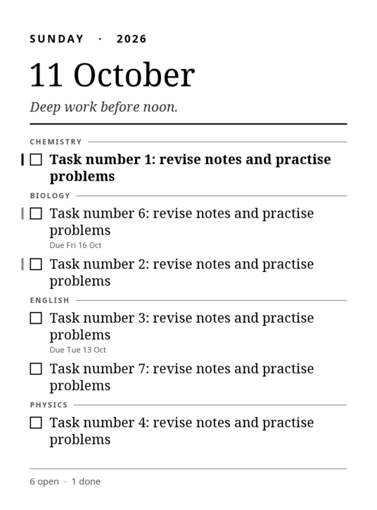
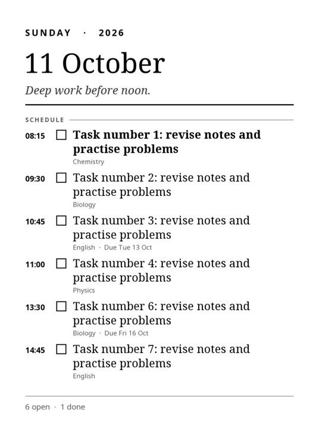
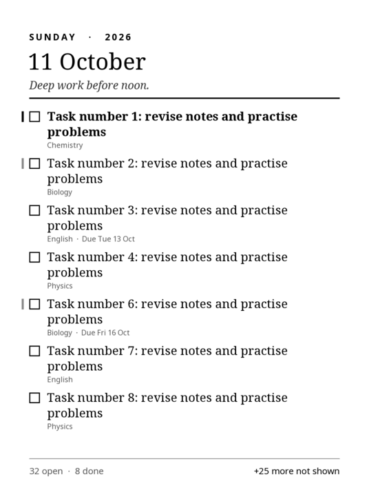
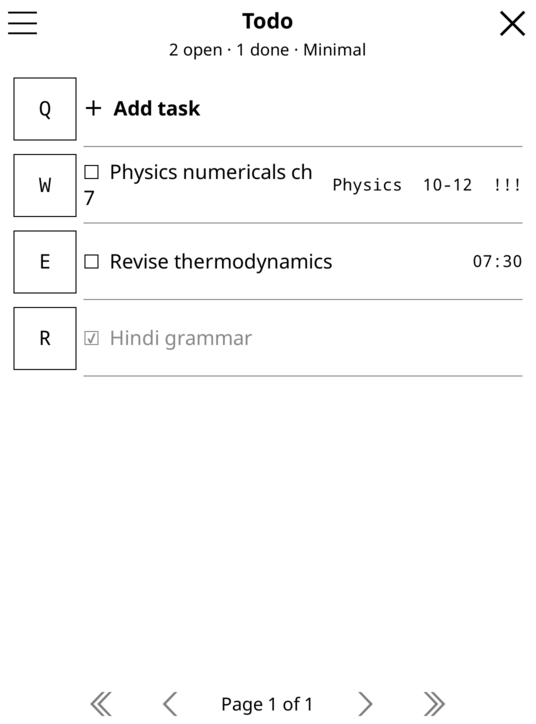
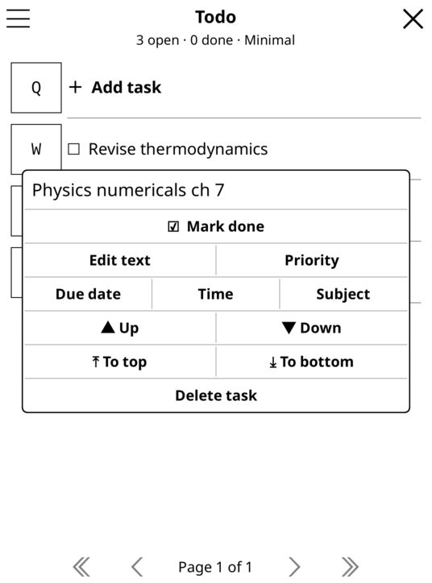

# KindleTodo

A paper-style todo list for jailbroken 10th-generation Kindles: the **Paperwhite 4** (2018, 1072×1448) and the **Kindle 10th gen / "Basic 3"** (2019, 600×800, verified working on real hardware). The wallpaper is laid out for the actual screen, so text has the same physical size on both.
You edit tasks on the Kindle itself, and the list becomes the Kindle's **sleep screen**.

```
Open editor ("Todo list" in the library, or KUAL) → edit tasks → saved to todo.json → wallpaper.png rendered + validated
→ Kindle goes to sleep → sleep hook paints the image → wake up → normal Kindle reading
```

No laptop, server, cloud account, network or background polling.

| Minimal | Study planner | Time-blocked | 40 tasks (overflow) |
|---|---|---|---|
|  |  |  |  |

Editor on the device (KOReader UI with large rows; the tap menu for one task):

 

---

## 1. Architecture

KindleTodo is built on **KOReader**, a reader with a touch UI framework, which jailbroken Kindles commonly have. It adds no new runtime. It launches from a KMC library scriptlet (`documents/KindleTodo.sh`, shown as **Todo list**) or from KUAL if installed.

| Part | What it is | File(s) |
|---|---|---|
| Todo editor | KOReader plugin: full-screen list with large rows, KOReader's on-screen keyboard, date/time pickers | `koreader/plugins/kindletodo.koplugin/main.lua` |
| Task store | One human-readable JSON file with atomic save, `.bak` backup, corruption recovery and duplicate protection | `kindletodo_store.lua`, `kindletodo_json.lua` |
| Renderer | Draws straight into an 8-bit grayscale buffer with KOReader's FreeType and PNG bindings. Has no UI dependencies, so it also runs headless. Deterministic output. | `kindletodo_render.lua` |
| Wallpaper pipeline | Renders to a temp file, validates the PNG (signature, IHDR 1072×1448 8-bit gray, IEND), keeps the previous image, then swaps the new one in | `kindletodo_wallpaper.lua` |
| Headless CLI | `render`, `render-if-stale`, `check`, run with KOReader's own `luajit` | `kindletodo_cli.lua` |
| Sleep hook + helper | busybox `sh` script: launcher, sleep hook, diagnostics, uninstall (also a KUAL menu if KUAL is present) | `extensions/kindletodo/`, `documents/KindleTodo.sh` |

### How the sleep screen gets updated

The stock Kindle UI draws its sleep screen itself, from images on the read-only root filesystem. Changing those images means remounting the rootfs and risks a hang if an image is malformed. **KindleTodo leaves them alone.** Instead:

1. The sleep hook sits blocked in `lipc-wait-event -m com.lab126.powerd goingToScreenSaver,outOfScreenSaver,readyToSuspend`. That is an event subscription, not polling, and it uses zero CPU while you read.
2. On `goingToScreenSaver`, it runs `render-if-stale`. This re-renders only if the **date** or the **tasks** changed since the last render (it compares a content hash), so the date on the sleep screen stays current with no daily timer.
3. It waits 2 s for the stock screensaver (or ad) to finish drawing, then paints `wallpaper.png` on top with the stock `eips -f -g`. If that fails, it falls back to a full FBInk at `/mnt/us/libkh/bin/fbink` if one is present.
4. If `readyToSuspend` arrives before the 2 s are up, it paints right then. It paints only once per sleep.
5. If you wake the device within the delay (`outOfScreenSaver`), it cancels the paint, so it never draws over your book.

**When KOReader is in the foreground** at sleep time, KOReader draws its own sleep screen. The plugin points KOReader's *"Show custom image or cover on sleep screen"* at `wallpaper.png`. Your previous choice is remembered and restored when you switch this off. In this case the hook stands aside.

The editor saves every change immediately. It re-renders the wallpaper **2 s after the last change**, so a burst of edits costs one render, and it always renders on close.

---

## 2. Prerequisites

| Requirement | Reference device (Kindle 10th gen) |
|---|---|
| Jailbreak | jb.sh v1.3.7 (KMC, kindlehf), FW 5.18.1.1.1 ✔ |
| KOReader in `/mnt/us/koreader` (kindlehf build on FW ≥ 5.16.3) | v2026.07.1 via KMC `kpm` ✔ |
| Launcher | KMC scriptlets (`.sh` in documents with `# Name:`) ✔; KUAL not installed (optional) |
| Image painter | stock `eips`; image-capable FBInk in `/mnt/us/libkh/bin` ✔ (fallback) |

## 3. Installation

Everything goes into the Kindle's user storage (`/mnt/us`, the USB drive). **No system files are changed**, and nothing existing is overwritten:

```
<Kindle>/extensions/kindletodo/                  helper script (+ KUAL menu, unused without KUAL)
<Kindle>/koreader/plugins/kindletodo.koplugin/   the editor + renderer
<Kindle>/documents/KindleTodo.sh                 "Todo list" launcher in the library
<Kindle>/kindletodo/                             your data (created on first run)
```

1. `make dist`, then copy the zip's **contents** to the Kindle drive root.
2. Eject. In the library, tap **Todo list**. KOReader opens straight into the list, and the sleep hook starts.
3. Add a task, then tap **✕** (or ☰ › *Done — back to Kindle*). KOReader exits back to the stock home screen.
4. Press the power button. The list should appear about 2 s after the stock sleep screen.
5. If it doesn't: open **Todo list** › ☰ › **Diagnostics**. The report is also saved in `kindletodo/diagnostics.txt`.

The sleep hook lasts until reboot. After a reboot, opening **Todo list** once re-arms it. (A start-at-boot option would need a file in `/etc/upstart`, which I left out on purpose.)

## 4. Usage

- **Add**: *＋ Add task*. **Add + next** keeps the keyboard open for quick entry. Duplicate open tasks are refused, so a double tap doesn't add twice.
- **Tap a task**: Mark done · Edit text · Priority · Due date · Time · Subject · Up/Down · To top/bottom · Delete (asks to confirm).
- **Long-press a task**: toggle done.
- **☰ menu**: layout (Minimal / Priority first / Study planner / Time-blocked), daily intention line, show completed, show due dates, use as KOReader sleep screen, Preview, Regenerate now, Clear completed (asks to confirm), exit.
- **☰ › Sleep hook: on/off** and **Diagnostics** manage the sleep screen from inside the editor.
- In KOReader it's also under **Tools › Todo list**, and **"Todo list"** can be bound to a gesture.

Layouts: *Study planner* groups by **Subject**, ordered by due date. *Time-blocked* sorts by **Time** with an "Anytime" group. *Priority first* groups High/Medium/Low. High priority shows **bold** with a black margin bar; medium gets a gray bar.

**When there are more tasks than fit**, the renderer tries these in order: shrink the text to 88% → drop completed tasks (they still count in the footer) → shrink down to 76% → compact header → show the first N tasks plus "+K more not shown". Titles wrap to 2–3 lines and then end in "…"; they're never clipped.

## 5. Files on the Kindle

```
/mnt/us/kindletodo/todo.json            tasks + settings (source of truth, readable JSON)
/mnt/us/kindletodo/todo.json.bak        previous good version
/mnt/us/kindletodo/todo.json.corrupt-*  only if a damaged file was ever found (never deleted)
/mnt/us/kindletodo/wallpaper.png        active sleep image (screen-sized 8-bit grayscale)
/mnt/us/kindletodo/screen.size          panel size recorded by the editor (e.g. 600x800)
/mnt/us/kindletodo/diagnostics.txt      last diagnostics report
/mnt/us/kindletodo/wallpaper.prev.png   previous good image
/mnt/us/kindletodo/kindletodo.log       short log (self-trimming)
/mnt/us/kindletodo/paint_delay          optional: seconds to wait before painting (default 2)
```

## 6. Troubleshooting

| Symptom | Check |
|---|---|
| Stock screensaver shows, no todo | Editor ☰ shows `Sleep hook: off`: tap it. If diagnostics shows `eips -g: FAILED`, the hook falls back to libkh FBInk automatically. Check `kindletodo.log`. |
| Todo appears, then the stock image covers it | The stock screensaver drew late. Put `4` in `/mnt/us/kindletodo/paint_delay`. |
| "Sleep screen NOT updated" in the editor | The message gives the reason. The previous image is kept. See `kindletodo.log`. |
| Image is stale | Editor ☰ › **Regenerate now**. Check `last render` in diagnostics. |

## 7. Restore / uninstall

- **Stock sleep screen, keep the app**: Editor ☰ › *Sleep hook: off*. ☰ › *Also KOReader sleep screen: off* restores your previous KOReader sleep-screen setting.
- **Uninstall**: first set *Also KOReader sleep screen: off*. Then over USB delete `extensions/kindletodo`, `koreader/plugins/kindletodo.koplugin` and `documents/KindleTodo.sh`. Delete `kindletodo/` too if you don't want to keep your tasks. A reboot clears the hook's temporary files in `/var/tmp`. Books and documents are never touched. (`kindletodo.sh uninstall` does the same from KUAL, if you ever install it.)

## 8. Compatibility report

**Verified (off-device, on this build machine, against the real KOReader v2026.07.1 packages):**
- The renderer, store and pipeline pass **27 automated tests** (`make test KOREADER_DIR=…`). They cover CRUD, reorder, duplicate protection, restart persistence, corrupt-file recovery, all 4 layouts, byte-identical output for identical input, overflow, long titles, the empty list, render failure keeping the old image, and PNG validation.
- The output is a screen-sized (**600×800** here, 1072×1448 on a PW4) **8-bit grayscale (color type 0)** PNG, the format the Kindle's own screensaver images use.
- The **editor was exercised inside real KOReader** (Linux build, offscreen at 1072×1448) by a scripted driver. That run covered opening from the launch flag, adding (including the duplicate rejection), priority, due date set and clear, time, new subject, hold-to-toggle, move, layout switch, intention, render, the KOReader sleep-screen setting, preview, clear completed, and close-renders.
- The **sleep hook state machine** ran under `sh` with stubbed `lipc-wait-event`/`eips`. It renders when stale, paints once after the delay, doesn't paint if woken early, paints once on an early `readyToSuspend`, and starts/stops cleanly.
- From the KOReader Kindle package source: PW4 serial codes (`0PP 0T1–0T7 0TJ–0TN 102 103 16Q–16V`), `goingToScreenSaver`/`outOfScreenSaver` from `com.lab126.powerd`, KUAL `config.xml`/`menu.json` format, and `koreader.sh --kual --asap`. KOReader's bundled `fbink` has **image support compiled out**, which is why the hook uses stock `eips`.

**Checked on the connected Kindle over USB (read-only):** the model is a Kindle 10th gen (serial code `0VB`; KOReader's log says `KindleBasic3`), FW 5.18.1.1.1, KOReader v2026.07.1 kindlehf, KMC `kpm` launcher, and an image-capable libkh FBInk.

**Not yet verified on the running device** (USB mode only exposes storage). Run diagnostics to confirm:
- `eips -f -g file.png` drawing the image on your firmware. This is widely used and is the diagnostics' live test.
- The 2 s paint delay being enough on your firmware. It's tunable via `paint_delay`.
- That the detached sleep hook survives KOReader exiting (it's started with `nohup` from a `/var/tmp` copy).
- How the hook coexists with Special Offers screens and "Show cover on lock screen". It paints over them; there may be one extra flash.
- Render time on the PW4 CPU. Expect well under ~1–2 s. The hook allows for it before painting.

## 9. Known limitations

- **It needs KOReader.** The editor and the renderer both use its runtime, since PW4 firmware has no other touch UI toolkit or image library that's scriptable. If you don't use KOReader for reading, it simply sits idle and only starts when you open the editor.
- **The image is painted over the stock sleep screen, not swapped into it.** Expect one brief flash of the stock image or ad before the todo appears.
- **The hook needs re-arming after a reboot** (opening the editor does it). There's no boot hook, because that would mean changing system files.
- **While the Kindle is in USB-drive mode**, `/mnt/us` is unavailable and the stock sleep screen shows.
- **Text uses KOReader's Noto fonts with simple left-to-right layout.** Latin, Devanagari and CJK glyphs render via fallbacks, but complex shaping (Arabic joining, Indic conjuncts) is not done on the wallpaper.
- **A task that would need more than 3 lines (2 when shrunk) is ellipsized on the wallpaper.** The full text stays in the editor.

## Development

```
make test KOREADER_DIR=/path/to/koreader-linux/lib/koreader   # 27 tests, samples in tests/out/
make dist                                                     # build/KindleTodo-1.0.zip
```

## License

MIT (see [LICENSE](LICENSE)). KindleTodo runs inside [KOReader](https://github.com/koreader/koreader), which is AGPL-3.0 and is installed separately; this repository contains no KOReader code. Not affiliated with Amazon. Jailbreaking your Kindle is at your own risk.
